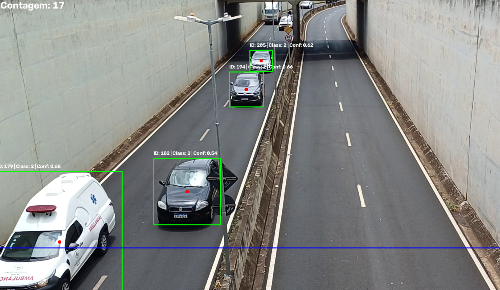
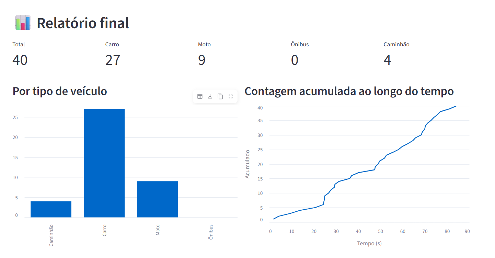

# Análise de tráfego com YOLOv8

Projeto de visão computacional que detecta, rastreia e conta veículos em um vídeo. O modelo YOLOv8 identifica os objetos e o ByteTrack mantém um ID para cada veículo ao longo dos frames. Um veículo é contado uma única vez quando cruza a linha de referência.

## Demonstração

### Detecção e rastreamento



### Relatório no Streamlit



## Funcionalidades

- Detecta carros, motocicletas, ônibus e caminhões.
- Exibe caixas delimitadoras, classe, confiança e ID de rastreamento.
- Conta veículos ao cruzarem uma linha horizontal, em um dos sentidos ou em ambos.
- Apresenta métricas por categoria, gráficos e tabela com os veículos contados.
- Permite baixar os dados da análise em CSV pelo painel.

## Requisitos

- Python 3.9 ou superior.
- Dependências listadas em `requirements.txt` e `pandas` para o relatório Streamlit.
- Um vídeo de entrada e o modelo `yolov8n.pt` (incluído neste repositório).

## Instalação

Crie e ative um ambiente virtual:

```powershell
python -m venv .venv
.venv\Scripts\Activate.ps1
```

No Linux ou macOS, use `source .venv/bin/activate` para ativá-lo.

Instale as dependências:

```bash
python -m pip install --upgrade pip
pip install -r requirements.txt
pip install pandas
```

## Vídeo de entrada

Coloque o vídeo em `data/viaduto.mp4` e ajuste `VIDEO_PATH` no início de `deteccao_carros.py` para apontar para esse arquivo. O caminho atualmente definido no script é específico de uma máquina Windows.

## Como executar

Para abrir a visualização de detecção em uma janela OpenCV:

```bash
python deteccao_carros.py
```

Para usar o painel interativo e consultar o relatório:

```bash
streamlit run relatorio.py
```

No painel, clique em **Iniciar** para processar o vídeo. Ao final, o relatório exibe a contagem total e por tipo de veículo, a evolução acumulada ao longo do tempo e a opção de baixar os registros em CSV.

## Configurações

As principais opções ficam no início de `deteccao_carros.py`:

- `MODEL_PATH`: caminho do modelo YOLO.
- `VIDEO_PATH`: caminho do vídeo de entrada.
- `CONFIDENCE`: confiança mínima para considerar uma detecção.
- `LINE_Y_RATIO`: posição vertical da linha de contagem, como proporção da altura do vídeo.
- `DIRECAO_CONTAGEM`: sentido da contagem (`"descendo"`, `"subindo"` ou `"ambos"`).

